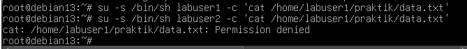

# Lab 5: Access Testing

## Tujuan

Menguji akses baca dan tulis ke file yang sama menggunakan akun latihan berbeda, lalu mengaitkan hasilnya dengan ownership, group, dan permission.

## Prasyarat dan Alat

- Debian GNU/Linux 13 dengan terminal Bash
- Akun `labuser1`, `labuser2`, dan group `labgroup`
- File `/home/labuser1/praktik/data.txt`
- Akses `sudo`, serta perintah `sudo`, `id`, `stat`, `printf`, `tee`, `test`, `cat`, dan `chmod`

## Konfigurasi Uji

| Item | Nilai awal untuk pengujian |
| --- | --- |
| File | `/home/labuser1/praktik/data.txt` |
| Permission yang dilaporkan | `640`: owner read/write, group read, others tanpa izin |
| Hasil baca `labuser2` | `Permission denied` |
| Owner dan group file saat pengujian | Belum terverifikasi dari screenshot |

## Perintah dan Langkah Praktik

1. Periksa keanggotaan dan metadata file sebelum menyimpulkan penyebab akses ditolak. Perintah berikut adalah pemeriksaan lanjutan yang disarankan; output-nya tidak tampak pada screenshot:

   ```bash
   id labuser1
   id labuser2
   stat -c '%A (%a) %U:%G %n' /home/labuser1/praktik/data.txt
   namei -l /home/labuser1/praktik/data.txt
   ```

   `id` memeriksa group efektif akun, `stat` memeriksa permission dan ownership file, sedangkan `namei -l` menunjukkan permission setiap direktori pada path. Jika tersedia, `getfacl /home/labuser1/praktik/data.txt` dapat digunakan untuk memeriksa ACL.

2. Pada praktik yang dilaporkan, ownership diatur menggunakan `chown` dan permission file diatur ke `640`. Nilai owner/group yang diberikan oleh `chown` tidak terlihat pada bukti yang tersedia, sehingga periksa metadata sebelum menyebutkan hasil ownership. Contoh perintah permission untuk file tersebut:

   ```bash
   chmod 640 /home/labuser1/praktik/data.txt
   stat -c '%A (%a) %U:%G %n' /home/labuser1/praktik/data.txt
   ```

3. Uji baca file sebagai kedua akun. Contoh di bawah menjalankan `cat` dengan identitas masing-masing akun. Screenshot yang disertakan menunjukkan percobaan baca sebagai `labuser2` berakhir dengan `Permission denied`:

   ```bash
   su -s /bin/bash labuser1 -c 'cat /home/labuser1/praktik/data.txt'
   su -s /bin/bash labuser2 -c 'cat /home/labuser1/praktik/data.txt'
   ```

   Jangan menafsirkan tidak adanya teks dari perintah `cat` pertama sebagai bukti pasti bahwa akses berhasil; file kosong juga tidak menampilkan isi. Simpan output dan status keluar aktual saat pengujian ulang.

## Hasil Praktik dan Analisis

Hasil terakhir yang dilaporkan adalah `Permission denied` ketika `labuser2` membaca `/home/labuser1/praktik/data.txt`. Screenshot berikut memperlihatkan hasil tersebut. Tidak ada bukti bahwa penolakan akses telah diperbaiki.



Dengan mode `640`, owner memiliki `rw-`, group memiliki `r--`, dan others tidak memiliki izin. Jika `labuser2` bukan owner, file dimiliki group `labgroup`, akun itu efektif menjadi anggota `labgroup`, dan seluruh direktori pada path dapat ditelusuri, bit baca group semestinya memberi akses. Karena hasil aktualnya ditolak, satu atau lebih kondisi tersebut mungkin tidak terpenuhi. Kemungkinan yang perlu diperiksa meliputi:

- group pemilik file bukan `labgroup`, atau ownership file berbeda dari yang diasumsikan;
- keanggotaan `labuser2` pada `labgroup` belum efektif pada konteks/sesi pengujian;
- permission execute (`x`) pada `/home`, `/home/labuser1`, atau `/home/labuser1/praktik` tidak mengizinkan traversal;
- ACL atau kebijakan pembatasan akses lain memengaruhi hasil.

Kemungkinan tersebut belum dibuktikan oleh screenshot. Periksa `id`, `stat`, `namei -l`, dan bila tersedia `getfacl`; jangan mengubah permission secara luas hanya untuk menghilangkan pesan penolakan.

## Penjelasan Perintah

| Perintah | Fungsi |
| --- | --- |
| `id user` | Menampilkan UID, GID, dan group, contoh `id labuser2`. |
| `stat -c format file` | Memeriksa mode dan owner; format `'%A (%a) %U:%G %n'` menampilkan permission simbolik/numerik serta owner/group/path. |
| `namei -l path` | Memeriksa permission tiap komponen direktori dan file pada path. |
| `getfacl file` | Memeriksa ACL jika utilitas tersedia pada sistem. |
| `chmod 640 file` | Mengatur owner `rw`, group `r`, dan others tanpa izin. |
| `su -s /bin/bash user -c 'perintah'` | Menjalankan perintah menggunakan shell dan identitas user yang disebut; contoh pengujian ada pada langkah 3. |
| `cat file` | Mencoba membaca isi file dengan hak akun yang menjalankannya. |

## Hasil yang Diharapkan

**Hasil aktual:** percobaan baca `labuser2` ditolak dengan `Permission denied`. Hasil ini tetap menjadi hasil pengujian yang dilaporkan; jangan menggantinya dengan target teoritis atau menyatakan bahwa akses sudah diperbaiki. Owner/group, permission direktori, keanggotaan efektif, dan ACL belum terverifikasi pada bukti yang tersedia.

## Kesimpulan

Jelaskan hasil uji yang benar-benar diperoleh dan hubungkan dengan metadata file serta permission direktori. Untuk bukti saat ini, simpulkan bahwa `labuser2` mendapat `Permission denied`; penyebab spesifik belum dapat dipastikan dari screenshot saja.

## Bukti Praktik

Isi [template catatan praktik](evidence/catatan-praktik.md) dengan perintah yang dijalankan, output terminal asli, dan penjelasan hasil. Jangan mengisi output sebelum menjalankan praktik.
